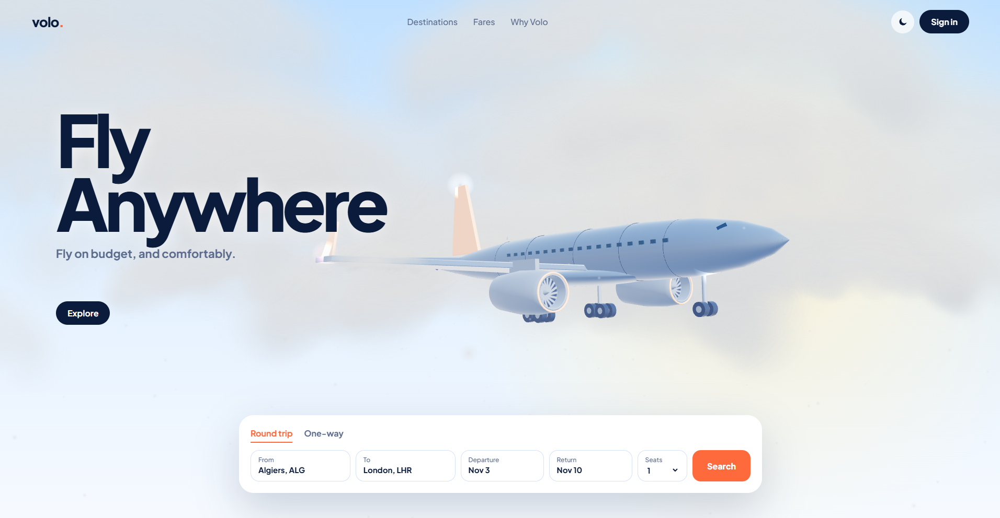
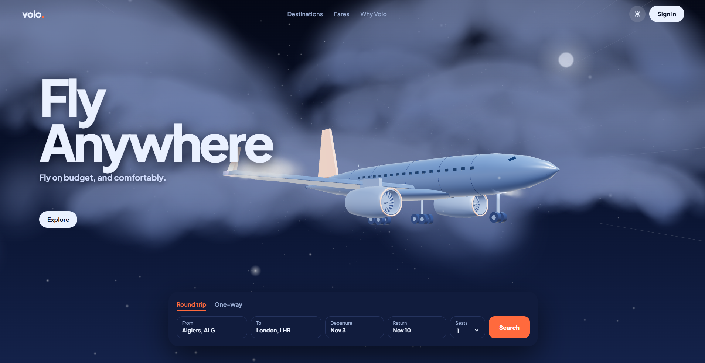

# ✈️ Volo — Flight Booking Reimagined

  

  <strong>Beyond the ordinary. Your journey starts before takeoff.</strong>

  
  
  

**Volo** is a creative flight-booking website concept that transforms the traditional travel experience into an immersive digital journey.

Built around cinematic motion, a dynamic 3D airplane, and scroll-driven storytelling, Volo explores a more engaging way to discover and book flights.

## 🌐 Live Experience

  

> Replace `YOUR_VOLO_WEBSITE_URL` with your deployed website URL.

## ✨ Highlights

- **Immersive 3D Aircraft** — an animated airplane that moves through the experience as the user scrolls.
- **Scroll-Driven Storytelling** — cinematic transitions designed to make the interface feel alive.
- **Modern Booking Concept** — a contemporary interface inspired by premium travel experiences.
- **Motion-Focused Design** — smooth visual transitions and carefully composed sections.
- **Responsive Interface** — designed with different screen sizes in mind.

## 🖼️ Preview

  

## 🛠️ Technologies

*Keep only the technologies actually used in the project.*

## 📱 Connect

  

## 📄 License

This project is presented as a design and development showcase. Add a license file if you intend to distribute or reuse the code under specific terms.

---

  <strong>VOLO</strong> 
  Your journey starts before takeoff.

